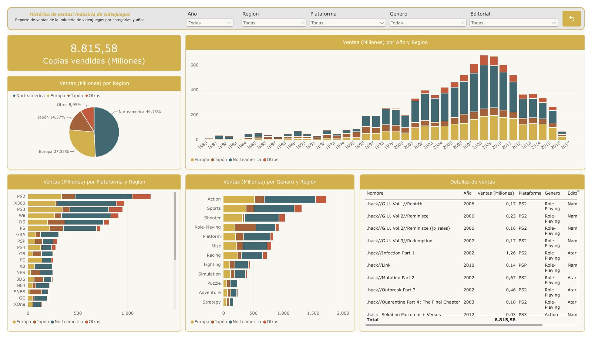

# Ventas históricas de videojuegos

Tablero de Power BI para explorar cómo se distribuyen las ventas de videojuegos por año, región, plataforma, género y editorial. La vista general reúne la evolución anual, la participación regional y una tabla con el detalle por título.

**Autor** · Juan Diego Londoño Álvarez  
**Contexto** · Proyecto de curso de Power BI en Udemy  
**Herramientas** · Power BI, Power Query y Excel

## Qué construí

- Organicé las columnas de ventas de Norteamérica, Europa, Japón y otros mercados en una estructura que permite filtrar y comparar las cuatro regiones.
- Diseñé una página que combina el total de copias, las ventas por año y región, y los rankings de plataformas y géneros.
- Añadí filtros por año, región, plataforma, género y editorial para pasar del panorama general a un segmento o título específico.

## Hallazgos

- **Norteamérica concentra el 49,15 %** de las copias registradas, frente al 27,33 % de Europa.
- **PS2 es la plataforma con mayor volumen** en la muestra, con **1.233,57 millones** de copias.
- **2008 es el año de lanzamiento con mayor volumen acumulado** en la base, con **678,50 millones** de copias.

## Datos y alcance

La fuente es un archivo de Excel suministrado en el curso, con **16.326 registros** y años de lanzamiento entre **1980 y 2017**. El indicador principal suma las cuatro columnas regionales y muestra **8.815,58 millones de copias** en la vista general.

Cada barra reúne las copias acumuladas de los títulos de un mismo **año de lanzamiento**. La cobertura varía entre años y solo hay tres registros para 2017.

La captura se exportó desde el tablero con todos los filtros abiertos.
